# VPS云主机配置

VPS 云主机，简单来讲就是通过云计算或虚拟化技术提供给你使用的虚拟服务器。 你可以把它理解成一台放在机房里、可以通过网络远程操作的电脑，不需要自己购买和维护实体服务器。

通过VPS云主机我们可以搭建网站、运行自动化程序、部署代理服务等等，下面我们以[IPDEEP VPS云主机](https://www.ipdeep.cn/vps)为例，为大家讲解一下配置步骤。

## 一、Windows操作系统使用说明

1.购买后在，已购买vps云主机子页面查看一切配置信息

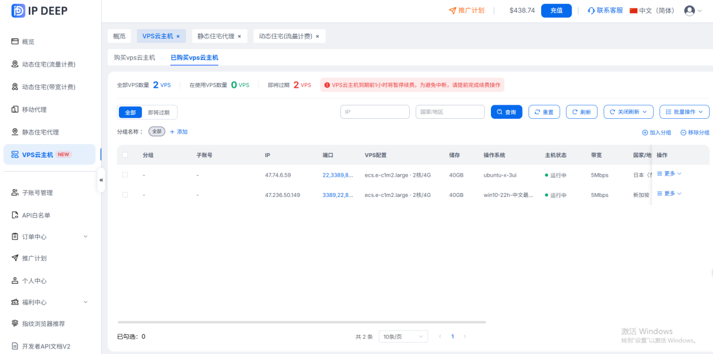

2.windows 连接工具是mstsc。电脑上搜索cmd命令提示符>输入mstsc>回车>弹出远程桌面窗口计算机输入框：输入IP，（如上图所示47.236.50.149）连接对应输入购买界面的用户名和密码确定

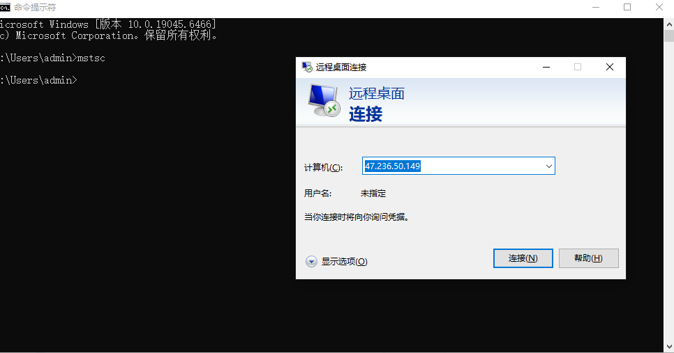

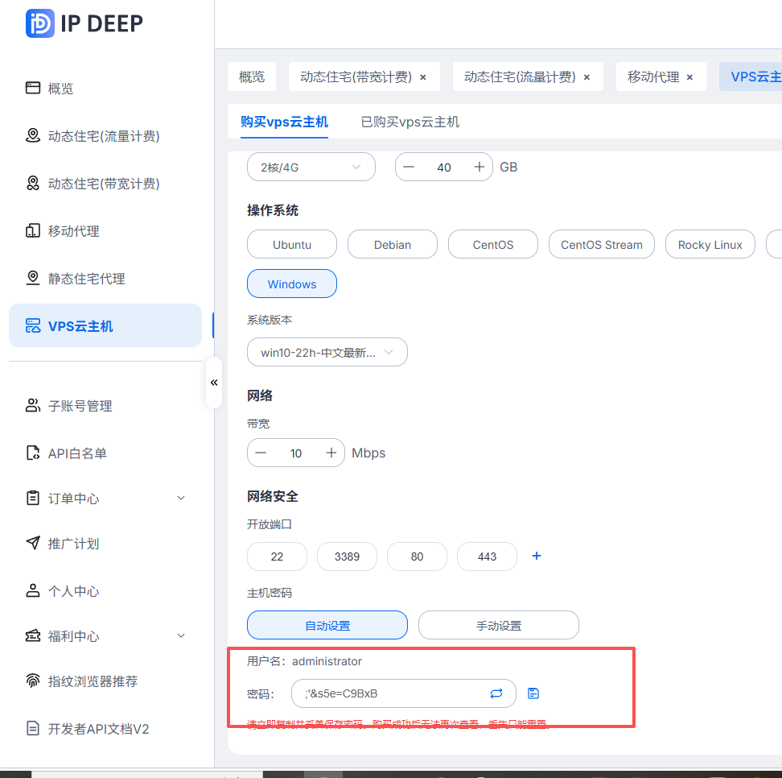

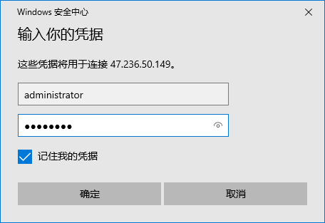

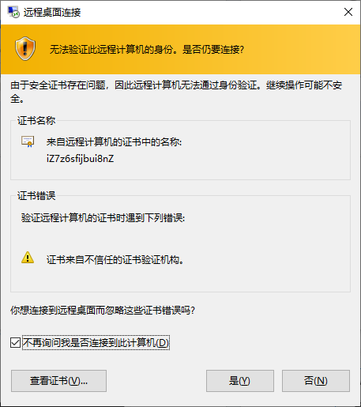

# 二、非Windows操作系统使用说明

1.非windows 连接工具Xshell 8（连接工具有很多，以此工具为例）下载地址为：[https://www.xshell.com/zh/free-for-home-school/](https://www.xshell.com/zh/free-for-home-school/)按要求免费注册后登陆

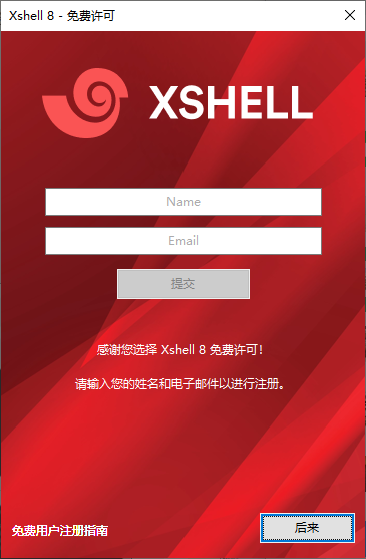

2.文件>新建>主机，填写购买的IP>连接>接受并保存>输入用户名>确定>输入密码>确定

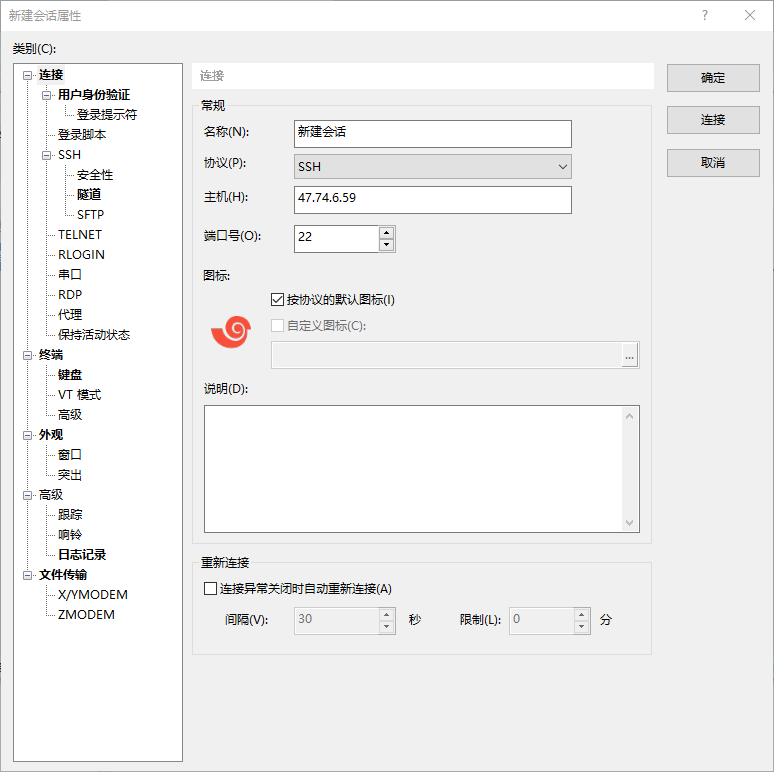

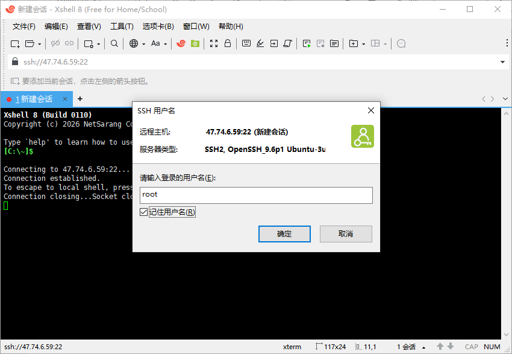

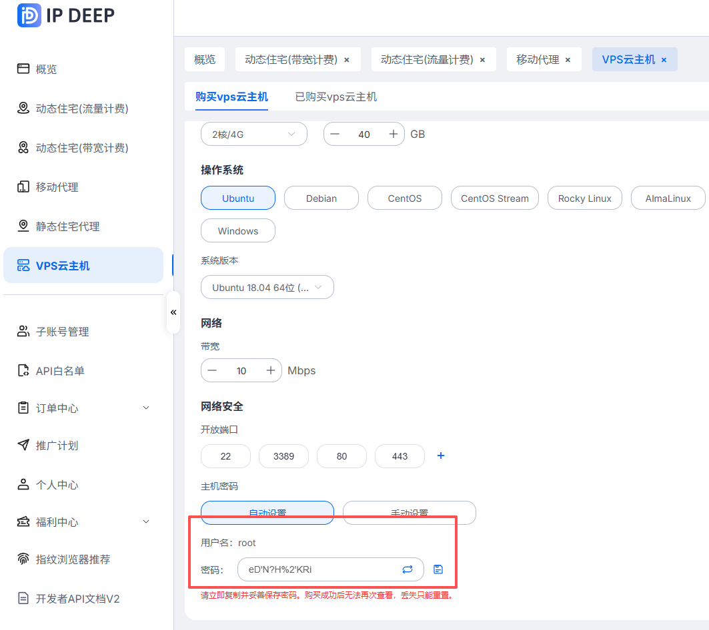

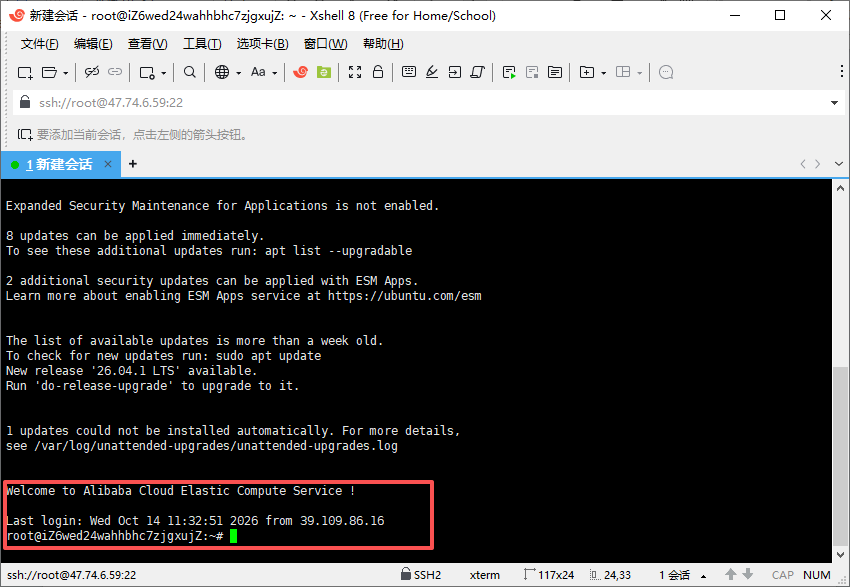

## 三、系统版本ubuntu-x-3ui 使用说明

1.登录这个网址Access URL: http://47.74.7.25:53443/Nc20vgCpAjOnZBRhvu ，地址里面的IP切换成自己购买的IP登录x-3ui的账号密码。

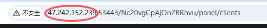

2.入站>添加入站>输入备注（方便后面用）>创建

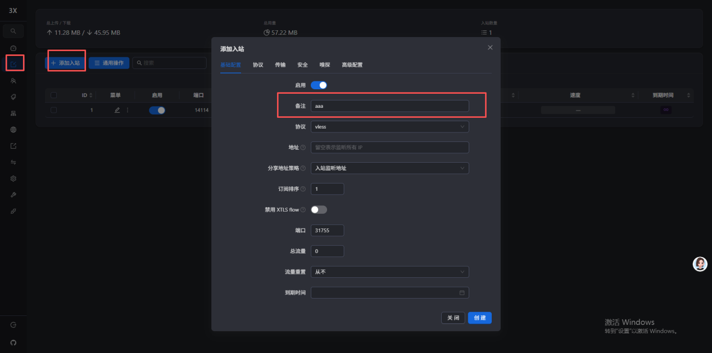

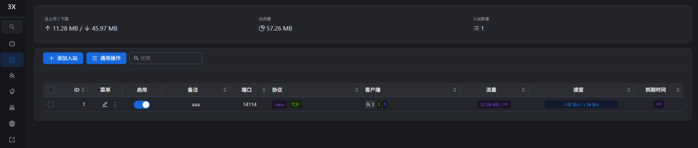

3.出站>加出站>协议选Socks>标签输入地址、端口、用户名、密码 (为您购买的IP deep静态或者动态IP代理信息创建)

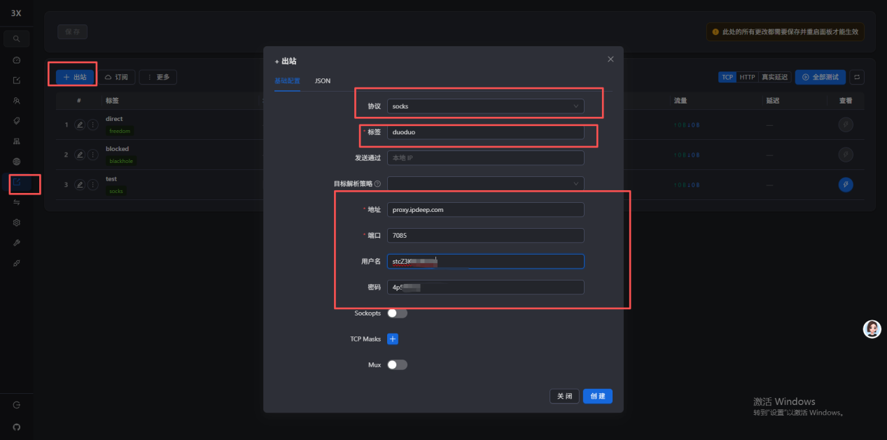

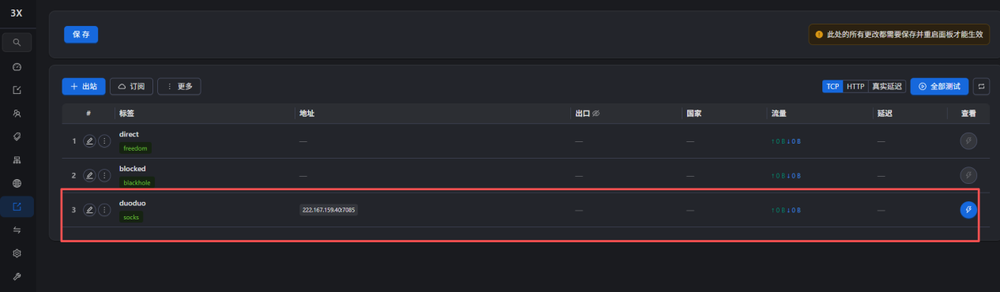

4.路由>路由规则>+路由规则>入站标签（选aaa）>出站标签（选duoduo）>创建保存

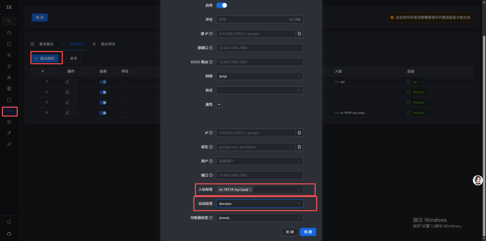

5.客户端>+添加客户端>邮箱按自己意思修改>关联入站（选aaa）>创建系统状态里面重启>二维码>vless>二维码复制粘贴到梯子里面即可。

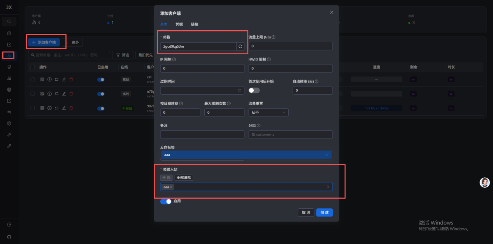

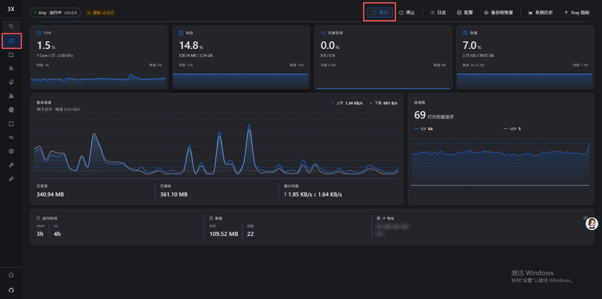

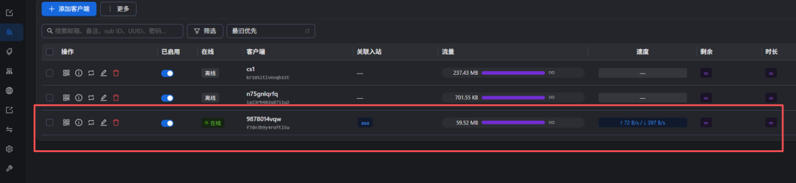

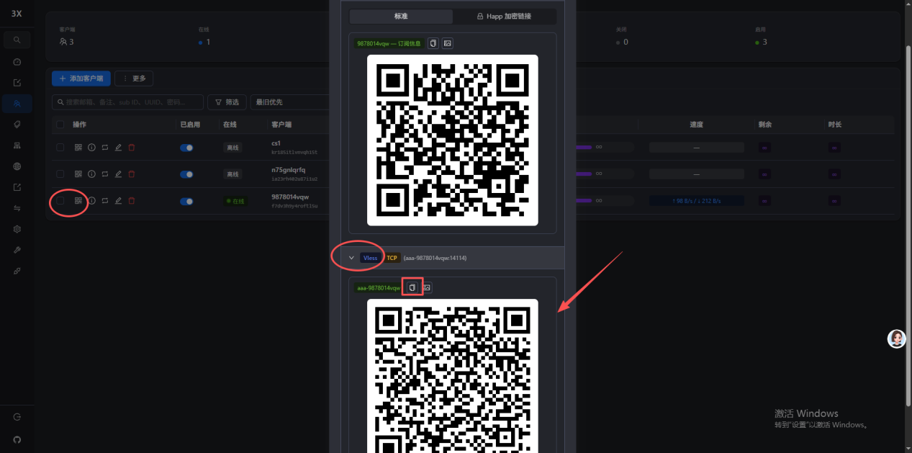

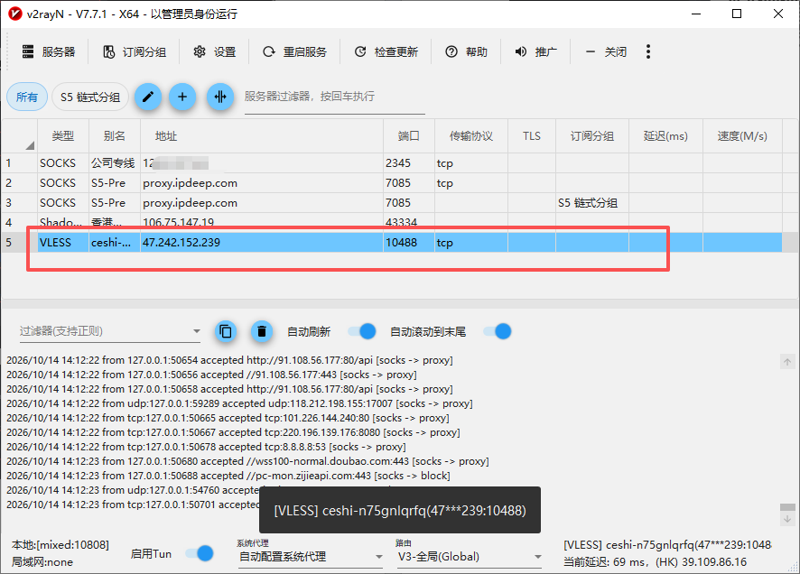

## 注意事项:

1. 客户端操作，遇到保存必保存。 

2. 客户端操作配置完毕要重启面板。 

3. 出站模块可以测IP的延迟。 

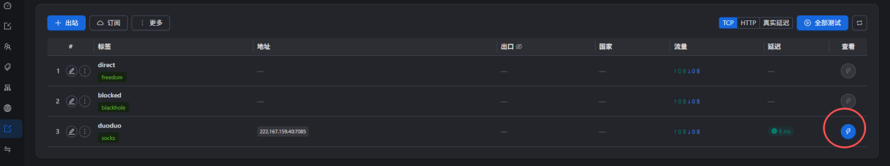

4. x-3ui建议买10Mbps以上的带宽 

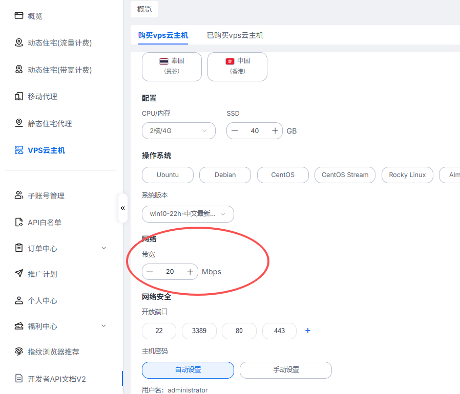

5. windows操作系统用户名统一为：administrator  

   非windows操作系统用户名统一为：root 
